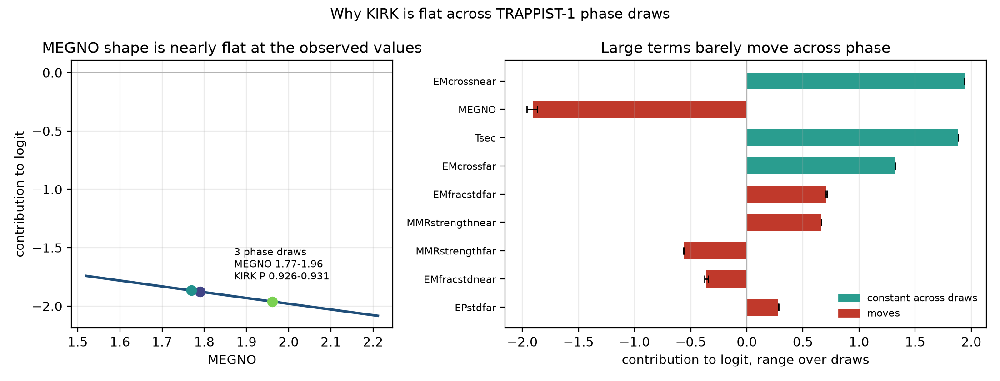

# KIRK


**KIRK** stands for *Klassified Inference of Resonant Kinetics*. Yes, with a K.
Otherwise the name doesn't fit the joke. Still doesn't make much sense. Idk I'm not clever enough.

This repo has two things:

- a glass-box distillation of SPOCK. Every prediction is a bias plus one curve
  per feature, so you can plot it and see why the model said stable.
- a scheduler that decides where to spend N-body time: short integration plus
  glass first, full MERCURIUS/IAS15 only for the systems that are actually
  borderline.

REBOUND does the integration, and SPOCK's feature pipeline is ported in-tree,
so `spock` is not imported at runtime. The glass model is the cheap first pass;
borderline systems get a full MERCURIUS/IAS15 run.

## Quickstart

After the install steps below, this predicts one system and gives you a lane:

```python
import rebound
from kirk import features, heads, scheduler

sim = rebound.Simulation()
sim.add(m=1.)
sim.add(m=1.e-5, P=1.0, e=0.03, pomega=2.0, l=0.5)
sim.add(m=1.e-5, P=1.2, e=0.03, pomega=3.0, l=3.0)
sim.add(m=1.e-5, P=1.5, e=0.03, pomega=1.5, l=2.0)
sim.move_to_com()

p = float(features.predict_stable(sim))   # SPOCK-shaped API, no spock import
print(f"{p:.3f} {scheduler.triage(p)}")
```

`predict_stable` takes the minimum over all adjacent trios, applies the Hill
rule for two planets, and zeroes anything that dies during the short run. It
also accepts a list of simulations. For the instability time and the
collision head:

```python
t = features.predict_instability_time(sim)
probs = heads.predict_collision(sim)
```

`triage` is the whole policy: above 0.70 trust stable, below 0.01 trust
unstable, in between pay for a real integration. The gates were tuned on the
Jupiter seeds 5-9; the results below are a fresh evaluation on seeds 10-12.
Gates are per-regime; move them and rerun.

You can read the model, too. Every prediction is a ledger, not a score:

```python
from kirk import glass
model, meta = glass.load_artifact("models/nam_spock_distilled.pt")
curves = model.shapes(meta)   # one curve per feature, raw units
```

`logit = bias + sum_i f_i(x_i)`. `curves[i]` is `(raw_grid, f_values)` for feature `i`
in `meta["feats"]` order, so a TRAPPIST-1 call can be itemized logit by logit
(`proofs/shape_phase.json: contributions`). If a curve looks wrong, edit it and
retrain or fix the feature. That is the point.

### What readability buys

- Audit. Leave-one-out on real archives with real 1e9 labels (`n=488`,
  `proofs/ablate.json:loo`, `scripts/ablate_glass.py`): neutralizing Tsec costs
  0.030 AUC, EMfracstdnear 0.030, EMcrossnear 0.018, EPstdnear 0.014, MEGNO
  0.012; MMRstrength near/far and EPstdfar cost ~0. Those three are prune
  candidates. A black box cannot nominate its own dead weight.
- Diagnosis. Same TRAPPIST-1 inner trio, three phase draws (`proofs/shape_phase.json`,
  `assets/shape_phase.png`): KIRK 0.926-0.931 while SPOCK moves 0.63-0.77.
  The ledger shows why: EMcross near/far and Tsec ranges are exactly 0.0 logit
  (phase-independent inputs), MMRstrength moves at 1e-4 level, MEGNO moves
  <0.1 logit over the observed 1.77-1.96 because its shape is flat there. The
  model is geometry-dominated and saturates high. That is a model limitation
  made visible, not a hidden phase effect.
- Trust. Five-bin calibration vs 1e9 labels (`proofs/ablate.json:calibration`):
  0.05 vs 0.06, 0.30 vs 0.19 (overconfident mid-low), 0.49 vs 0.46, 0.69 vs
  0.73, 0.93 vs 0.92. Curve spans (`proofs/ablate.json:shape_spans`) set
  expectations before deployment: MEGNO 2.32, Tsec 2.12, EMfracstdnear 1.62
  logits across train range; EPstdfar only 0.17.
- Edit path. `scripts/audit_models.py` + `models/index.json` say which artifact
  is a classifier and what API loads it. `scripts/train_glass.py` retrains from
  real ICs with provenance (data hashes, seed, epochs in `proofs/distill.json`).
  `scripts/plot_phase_case.py` and `scripts/plot_paper.py` regenerate the
  figures from proofs, no N-body needed.



Same TRAPPIST-1 inner trio, three phase draws. KIRK moves only 0.926–0.931,
while SPOCK moves 0.63–0.77. The curves show why: `EMcross` and `Tsec` are
exactly phase-independent, `MMRstrength` moves only at the 10^-3 level, the
`MEGNO` shape is nearly flat over the observed 1.77–1.96, and the remaining
phase-sensitive terms move by less than 0.1 logit. The additive model is
geometry-dominated and saturates at the top of the range. That is a real
limitation of the distilled model, not a hidden phase effect, and it is the
kind of thing the glass box is supposed to expose. Reproduce with `scripts/plot_phase_case.py`;
numbers are in `proofs/shape_phase.json`. The earlier inner-vs-outer case is
still in `proofs/shape_case.json` ([plot](assets/shape_case.png)). For a
single-image version with the full TRAPPIST-1 schematic, see
[`assets/trappist_kirk.png`](assets/trappist_kirk.png). For the synthetic
KIRK-lane orbit spread on the inner trio, see
[`assets/orbit_lanes.png`](assets/orbit_lanes.png). The same-benchmark summary
(ROC vs the teacher, plus one shape) is
[`assets/hero_benchmark.png`](assets/hero_benchmark.png). The SPOCK Fig. 3 and
Fig. 4 analogues with KIRK are
[`assets/spock_fig3_kirk.png`](assets/spock_fig3_kirk.png) and
[`assets/spock_fig4_kirk.png`](assets/spock_fig4_kirk.png).

## What is in the box

| Path | What it is |
|---|---|
| `src/kirk/glass.py` | NAM loading and prediction; MoE experiments are archived |
| `src/kirk/scheduler.py` | triage, reward, batch runner, summary |
| `src/kirk/features.py` | SPOCK pipeline + `predict_stable` / `predict_instability_time` |
| `src/kirk/heads.py` | collision and outcome heads |
| `src/kirk/short_features.py` | cheap 200-orbit features for the scheduler |
| `src/kirk/teacher.py` | SPOCK's XGBoost JSON in plain Python, no xgboost |
| `models/` | 5 usable artifacts; `models/archive/` keeps the experiments |
| `models/index.json` | which artifact loads, what head it has, what it is for |
| `scripts/` | training, evaluation, benchmarks, asset download |
| `proofs/` | machine-readable results |

`scripts/train_glass.py` is the trainer. It samples real initial conditions,
runs the ported exact feature pipeline, labels with the teacher, and writes the
`.pt` plus provenance. `--quick` gives a smoke-test run; the feature cache
means reruns with the same sample skip the expensive part.

`models/` has five loadable artifacts: `nam_spock_distilled.pt` and
`nam_spock_exact.pt` are stability classifiers, `nam_spock_deepreg.pt` gives
an instability time, `nam_spock_collision.pt` gives pair collision
probabilities, and `nam_spock_outcome.pt` gives post-merger orbits (pair (1,2)
only). The older experiments are in `models/archive/`. Run
`scripts/audit_models.py` and read `models/index.json` before loading one.

## Results

Table 1 replication, real initial conditions and real 1e9-orbit labels. AUC and
FPR at 0.5, SPOCK 2.0 Sec. 2 exclusions. These are point estimates from the
lab split (n=488 teacher, n=147 glass holdout). The glass rows are from the
shipped script, seed 8. 95% CIs are in `proofs/table1.json`; for the
Tsec+Tsec row, AUC [0.840, 0.943] and FPR [0.034, 0.151]:

| Features | Paper AUC / FPR | Teacher, my sample | Glass holdout |
|---|---|---|---|
| 1e4, old | 0.9430 / 0.1605 | — | 0.8563 / 0.1111 |
| Tsec, old | 0.9417 / 0.1660 | — | 0.8756 / 0.1000 |
| 1e4, +Tsec | 0.9442 / 0.1595 | — | 0.8384 / 0.1444 |
| Tsec, +Tsec | 0.9502 / 0.1431 | 0.9471 / 0.0903 | 0.8998 / 0.0889 |

The teacher numbers use Tsec features, which is what the SPOCK 2.x JSON in this
repo speaks. The other three paper columns are SPOCK 1 reference values, not
results from this repo.

The retrained distillation is a separate model, trained on 1818 real systems
with exact features. Holdout numbers: five-seed mean ± std, and the seed-0
artifact with 95% bootstrap intervals.

| Metric | Five seeds | Seed-0 artifact (quickstart) |
|---|---|---|
| Agreement with teacher | 0.893 ± 0.018 | 0.916 [0.883, 0.945] |
| AUC vs teacher | 0.971 ± 0.007 | 0.975 [0.959, 0.988] |
| AUC vs 1e9 truth | 0.916 ± 0.011 | 0.933 [0.904, 0.959] |
| Accuracy vs 1e9 truth | 0.836 ± 0.020 | 0.857 [0.813, 0.897] |

The mean is the headline; the seed-0 artifact is the one the quickstart loads.
The spread is in `proofs/distill.json`.

The scheduler benchmark, fresh evaluation set: 900 Jupiter-mass systems
(seeds 10-12, 300 each), 200-orbit screen, 10^4-orbit truth. Gates were fixed
on seeds 5-9, which are not in this set. No speedup is claimed; timings are
reported as diagnostics only:

| Seed | n | Acc [95% CI] | Zoom | Tight acc / zoom | Wide acc / zoom |
|---|---|---|---|---|---|
| 10 | 300 | 0.993 [0.983,1.0] | 51.7% | 1.00 / 5% | 0.987 / 98% |
| 11 | 300 | 1.000 [1.0,1.0] | 51.7% | 1.00 / 3% | 1.00 / 100% |
| 12 | 300 | 0.990 [0.977,1.0] | 51.3% | 0.993 / 5% | 0.987 / 97% |
| Total | 900 | 0.994 | 51.6% | 0.998 / 4.7% | 0.991 / 98.4% |

Pattern: tight → fast-unstable, wide → zoom. Scheduler saves on tight only;
wide pays truth. Free-1e9 check on real archives (`proofs/scheduler_real1e9.json`,
n=600): Jupiter gates give `zoom 42.8%, nonzoom acc 0.452` — do not transfer
to Earth-mass. Scheduler claim is Jupiter-only unless gates are retuned per regime.

The min-over-trios rule for larger systems was checked separately on synthetic
Earth-mass chains, 50 systems per planet count, 10^5-orbit truth.
Half the systems are compact and half wide (`proofs/multiplanet.json`):

| Planets | n | Truth stable | KIRK acc [95% CI] | KIRK AUC | Hill 6.75 |
|---|---|---|---|---|---|
| 3 | 50 | 0.84 | 0.62 [0.48,0.74] | 0.949 | 0.88 |
| 4 | 50 | 0.64 | 0.84 [0.74,0.94] | 0.983 | 0.86 |
| 5 | 50 | 0.56 | 0.92 [0.84,0.98] | 0.972 | 0.86 |
| 6 | 50 | 0.58 | 0.88 [0.78,0.96] | 0.993 | 0.90 |

At 10^5 orbits compact systems are often still stable while their 10^9 SPOCK
labels call them unstable — horizon limit, not classifier failure. KIRK AUC
0.95-0.99 shows ranking is excellent; acc at fixed 0.5 threshold trails Hill
on 3/4/6 because the threshold is not retuned per multiplicity. So min-over-trios
validates as no-harm aggregation with strong ranking; threshold needs
per-regime calibration. 4+ stays provisional. Run `make validate-multi` to reproduce.

## Reproducibility

```sh
make test
make quick      # smoke runs of training, scheduler and Table 1
make full       # the real runs; slower
make eval-scheduler  # 3 x 300 fresh Jupiter systems, 10^4-orbit truth
make validate-multi  # 3/4/5/6-planet check at 10^5-orbit truth, 50/count
make plot       # regenerate assets/shape_phase.png
make plot-trappist  # regenerate the TRAPPIST-1 schematic figure
make plot-orbits    # synthetic KIRK-lane orbit spread (inner trio)
make plot-hero      # ROC + one shape, from the full feature cache
make plot-spock-figs  # SPOCK Fig. 3/4 analogues with KIRK
```

`make quick` writes its smoke-test artifacts to `/tmp`; it does not overwrite
the committed models or proofs.

`scripts/benchmark_table1.py` needs the real archives; `--quick` is a pipeline
check, not the Table 1 numbers. The ported feature pipeline matches upstream
SPOCK to machine precision on the real systems used in `compare_spock.py`;
the classifier is the only thing swapped. For that optional cross-check:

```sh
make setup-spock
make check-spock
```

Tests run without the spock package, so CI is cheap.

## Limitations and failure modes

Measured by the shipped scripts. Paper scope is stability classification only;
collision / outcome / instability-time heads are not paper claims:

- Jupiter-mass systems. The teacher is off-distribution here, and the glass
  model follows it. Treat Jupiter runs as a triage stress test, not a
  correctness claim. Earth-mass resonant/random is the paper evaluation turf.
- Systems with 4+ planets. Min-over-trios is SPOCK's rule, validated as
  no-harm aggregation. Default is now 50/count at 10^5 orbits; rerun in
  progress. Treat 4+ predictions as provisional until that lands.
- Short truth horizons. At 10^4/10^5 orbits, a compact system can still be
  stable even though its 10^9 label is unstable. Complemented by real-archive
  evaluation against 1e9 labels where no integration is needed.
- Two-planet systems. By design there is no trio, so there is no classifier.
  KIRK and SPOCK both use the Hill rule.
- The instability time is a point estimate from a distilled NAM, not SPOCK's
  posterior with percentiles. Out of paper scope until calibrated.
- Collision head gives pair probabilities; outcome head was trained only on
  pair (1,2). Both out of paper scope until evaluated.

From earlier lab runs, not rerun in this release:

- WHFast-optimal Jupiter systems (the JPL check).
- Cold disks and migration twins.
- TTV-narrow posteriors.

Those were observed in the lab, but this repo does not currently ship a
benchmark for them. Do not quote them as results of this release.

## Install

There is no PyPI release yet. From the repo root:

```sh
make setup
```

That creates `~/kirk-env` (override with `KIRK_VENV=...`), installs the package
in editable mode with the data tools, downloads the teacher JSON and dataset,
and prepares the `npz` archives. It uses Python 3.12; override with
`PYTHON=/path/to/python3.12` if yours is elsewhere. CPU PyTorch is installed
by default; set `KIRK_TORCH_INDEX=https://download.pytorch.org/whl/cu121` (or
another CUDA index) if you want GPU torch.

REBOUND 4.6 is intentional: it is the version whose WHFast API the ported
feature pipeline uses. The core does not need the `spock` package. Install that
extra only for the feature-by-feature cross-check.

The download script fetches SPOCK's classifier JSON and their dataset. Their
licenses apply, and I do not redistribute either. The hashes are pinned so a
changed upstream file fails loudly instead of silently changing the results.

## Disclaimer

Parts of this code were cleaned up and prepared for release with assistance from
DeepSeek V4.1 Flash.

## Credits

Upstream work, in the order it matters: Tamayo et al. 2020 (PNAS) for SPOCK;
Thadhani et al. 2025 for SPOCK 2.0 and the Zenodo dataset; Rein & Tamayo 2017
for REBOUND; Hadden & Tamayo 2022 for celmech. Adapted file-by-file, headers
kept. GPL-3.0, same as upstream.
